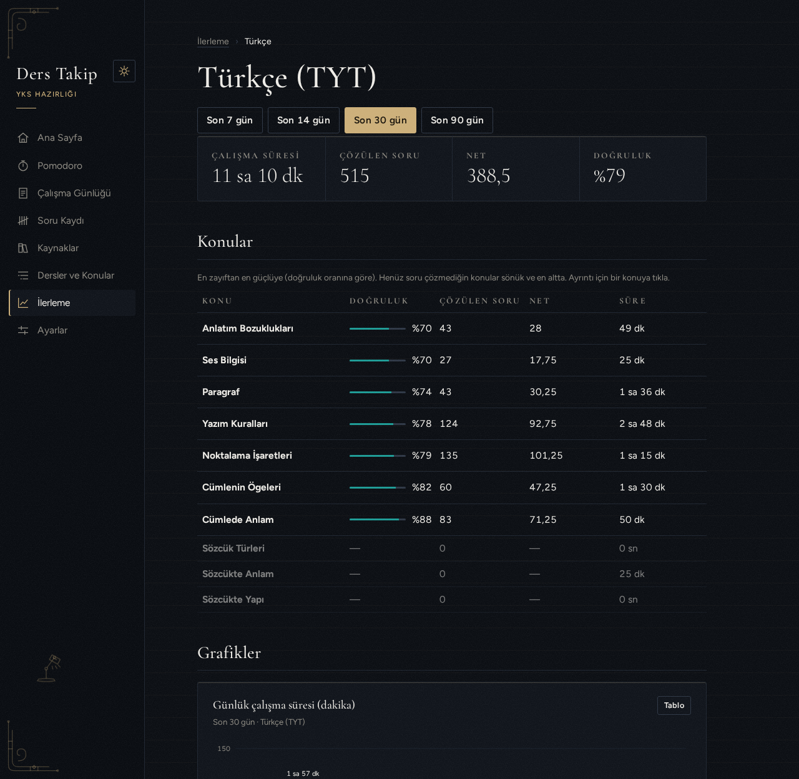
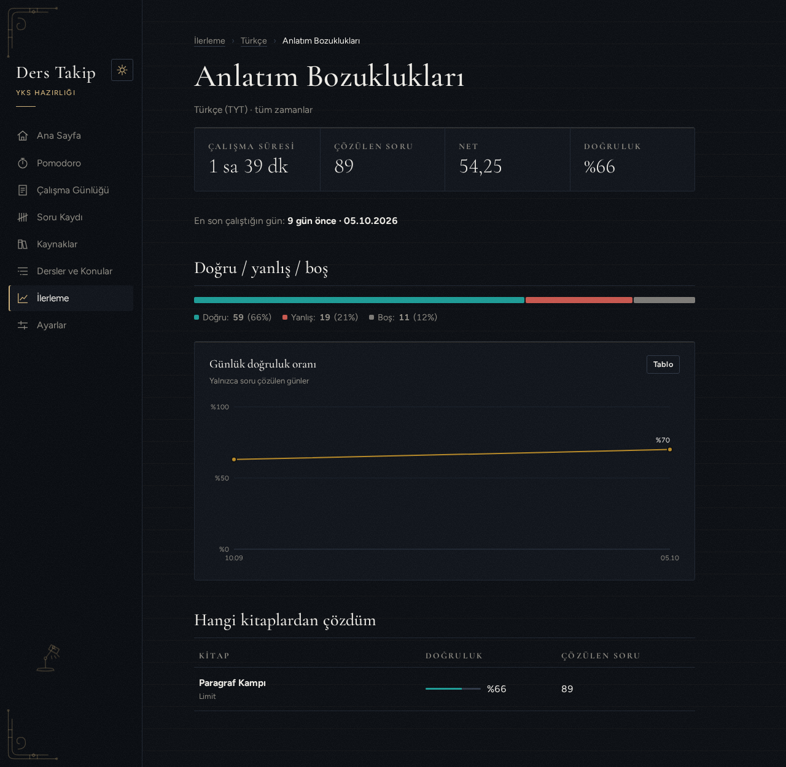
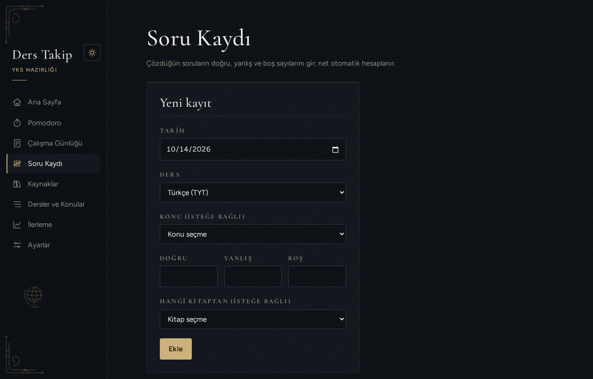
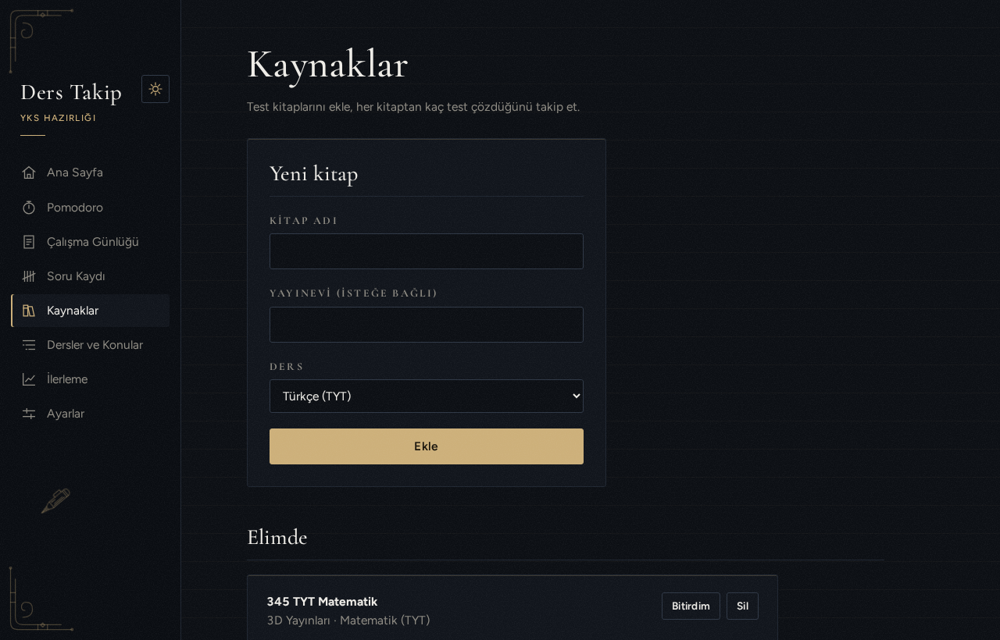
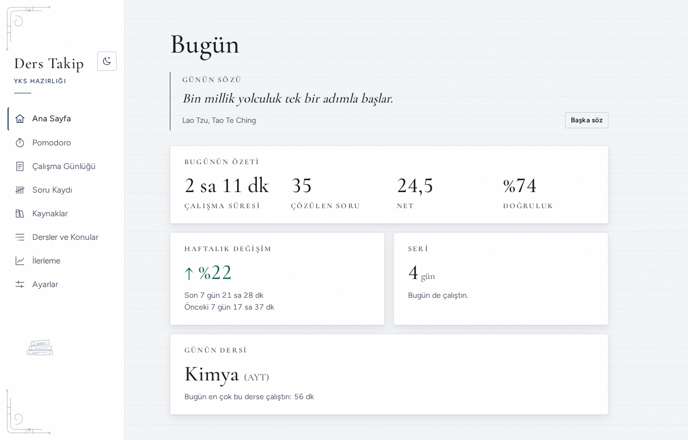
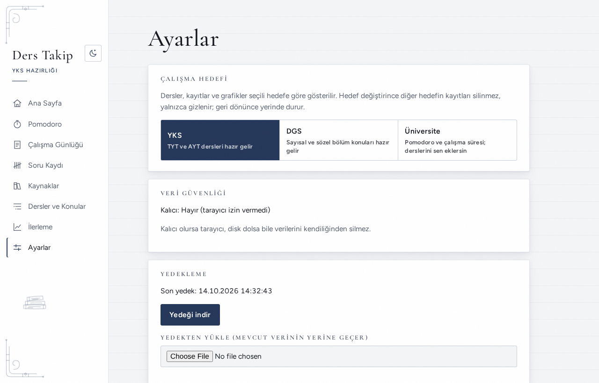
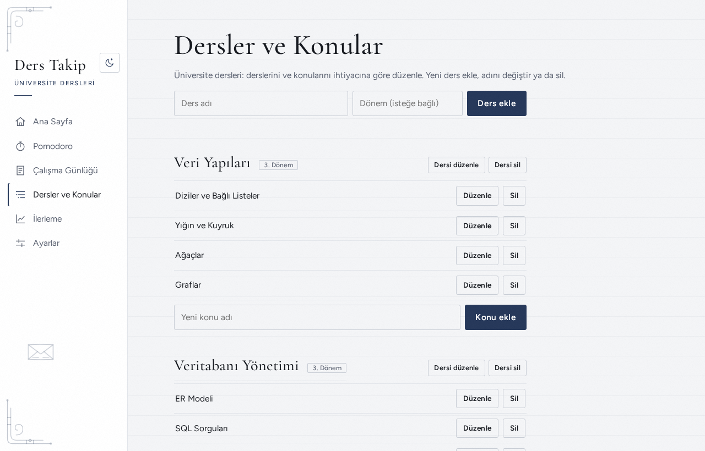
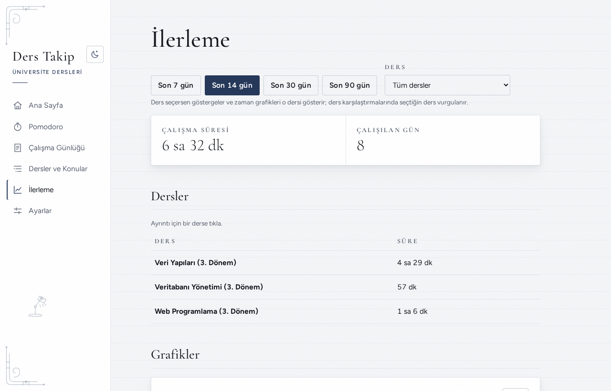

# Ders Takip

**YKS, DGS ve üniversite dersleri için kişisel çalışma takip uygulaması.** Pomodoro ile çalış, süreni ve çözdüğün soruları kaydet, test kitaplarında nerede kaldığını takip et, ilerlemeni grafiklerle gör.

[](https://github.com/yusufoztoprak495-star/ders-takip/actions/workflows/pages.yml)


### 👉 [Uygulamayı aç](https://yusufoztoprak495-star.github.io/ders-takip/)

Kurulum yok, hesap yok. Veriler yalnızca senin tarayıcında durur, hiçbir sunucuya gönderilmez. Telefonda "Ana ekrana ekle" ile uygulama gibi kurulur ve internetsiz de açılır.


## Neler yapabilir?

| | |
| --- | --- |
| 🎯 **Üç hedef** | YKS (TYT/AYT), DGS (sayısal/sözel) ya da üniversite dersleri. Her hedefin dersleri ve kayıtları ayrı tutulur; hedef değiştirince öbürü silinmez, gizlenir. |
| ⏱️ **Pomodoro** | Ders ve konu seçip sayacı başlat; süre dolunca çalışma kendiliğinden kaydedilir. Arkada sakin piyano, ambiyans, yağmur ya da gürültü çalabilir (tarayıcıda anlık üretilir, ses dosyası yok). |
| 📒 **Çalışma günlüğü** | Pomodoro dışındaki çalışmaları elle ekle. |
| ✍️ **Soru kaydı** | Doğru / yanlış / boş gir; net (`doğru − yanlış / 4`) ve doğruluk otomatik hesaplanır. |
| 📚 **Kaynaklar** | Test kitaplarında kaçıncı testte olduğun ve son çözüm tarihi. |
| 📈 **İlerleme** | Günlük ve haftalık süre, net değişimi, derse göre karşılaştırma; derse ve konuya inip **en zayıf konunu** gör. |
| 🗂️ **Dersler ve konular** | YKS sayısalın 15 dersi (TYT: Türkçe, Matematik, Geometri, Fizik, Kimya, Biyoloji, Tarih, Coğrafya, Felsefe, Din Kültürü; AYT: Matematik, Geometri, Fizik, Kimya, Biyoloji) tüm konularıyla, müfredat sırasında hazır gelir. Listeyi düzenle ya da kendi derslerini (dönemiyle) ekle. |
| 🌗 **Açık / koyu tema** | Gerçek beyaz açık tema ve gece mavisi koyu tema; masaüstünde sol menü, telefonda alt menü. |
| 💾 **Yedekleme** | Yedeği indir/yükle, haftalık hatırlatma, bilgisayarda bir klasöre günlük otomatik yedek. |

> Üniversite hedefinde sınav mantığı yoktur: soru kaydı, kaynaklar, net ve doğruluk gizlenir; yalnızca Pomodoro ve çalışma süresi tutulur.

## Ekran görüntüleri

| İlerleme | Ders ayrıntısı (konular zayıftan güçlüye) |
| --- | --- |
|  |  |

| Pomodoro | Konu ayrıntısı |
| --- | --- |
|  |  |

| Soru kaydı | Kaynaklar |
| --- | --- |
|  |  |

| Açık tema | Hedef seçimi |
| --- | --- |
|  |  |

| Üniversite: dersler | Üniversite: yalnızca süre |
| --- | --- |
|  |  |

<p align="center"></p>

> Görüntülerdeki veriler örnektir.

---

## Geliştirme

**Gereksinim:** [Node.js](https://nodejs.org) 22+ (yalnızca geliştirmek için; uygulamayı kullanmak için gerekmez).

```bash
git clone https://github.com/yusufoztoprak495-star/ders-takip.git
cd ders-takip
npm install
npm run dev        # http://localhost:5173
```

| Komut | Ne yapar |
| --- | --- |
| `npm run dev` | Geliştirme sunucusu, kod değiştikçe yenilenir |
| `npm test` | Tüm testler (Vitest) |
| `npm run build` | Derler (`client/dist`) |
| `npm run preview` | Derlenmiş hâli dener: `http://localhost:4173` |

Sunucu, veritabanı ya da `.env` yoktur. `master` dalına her gönderimde GitHub Actions testleri çalıştırır, derler ve GitHub Pages'e yayınlar (`.github/workflows/pages.yml`).

### Teknolojiler

| Katman | Seçim |
| --- | --- |
| Arayüz | React 19 + Vite, React Router (`HashRouter`: alt klasörde de çalışır) |
| Veri | Tarayıcıda IndexedDB, tek kayıt olarak (yazma atomik: ya hepsi ya hiçbiri) |
| Çevrimdışı | Manifest + servis çalışanı (`client/public/sw.js`) |
| Grafikler | Elle çizilmiş SVG, kütüphanesiz |
| Yazı tipi | Cormorant Garamond + Figtree, projeye gömülü (`@fontsource`) |
| Test | Vitest |

### Proje yapısı

```
client/
  public/            manifest, simge, servis çalışanı
  src/
    pages/           Ana sayfa, Pomodoro, Günlük, Soru Kaydı, Kaynaklar, Dersler ve Konular, İlerleme, Ayarlar
    components/      ortak parçalar, hedef seçici, Pomodoro kadranı, SVG grafikler, çizimler
    context/         Pomodoro sayacı, çalışma hedefi, klasör yedeği
    hooks/, lib/     saf yardımcılar (tarih, süre, grafik, tema, hedefler, yedek)
    data/            tarayıcıdaki veri katmanı (aşağıda)
    api.js           apiFetch('/api/...') çağrılarını yerel veri katmanına yönlendirir
  tests/             arayüz yardımcıları; tests/data/ veri katmanı
docs/                tasarım belgeleri, uygulama planları, ekran görüntüleri
```

### Veri katmanı

Proje önce Node.js + SQLite sunucusuyla yazıldı, sonra sunucusuz hâle getirildi. Sayfalar değişmesin diye `apiFetch('/api/...')` çağrıları aynen kaldı; artık ağa değil `client/src/data/` içindeki yerel veritabanına gidiyor.

| Yol | Açıklama |
| --- | --- |
| `/api/settings` | Seçili çalışma hedefi (`yks`, `dgs`, `uni`) |
| `/api/subjects` | Seçili hedefin dersleri, konularıyla; ders ekle / düzenle / sil |
| `/api/topics` | Konu ekle / yeniden adlandır / sil |
| `/api/sessions` | Çalışma kayıtları |
| `/api/questions` | Soru kayıtları (net hesaplanarak döner) |
| `/api/resources` | Test kitapları |
| `/api/stats/daily`, `by-subject`, `by-topic`, `topic/:id` | İstatistikler |

<details>
<summary><b>Kurallar</b> (doğrulama, net, gün sınırı, silme, hedefler)</summary>

- **Doğrulama veri katmanındadır.** Arayüzdeki kontroller yalnızca kolaylıktır; her girdiyi veri katmanı Türkçe mesajla reddeder (`HttpError` → arayüzde `ApiError`).
- **Net saklanmaz,** her seferinde `doğru − yanlış / 4` olarak hesaplanır. Doğruluk `doğru / (doğru + yanlış + boş)`; hiç soru yoksa `null` ("veri yok", sıfır değil).
- **Gün sınırı yereldir.** Çalışmalar UTC saklanır, istatistikler yerel güne göre ayrılır: gece 00:30'daki çalışma o günün sayılır.
- **Sınırlar:** bir çalışma en fazla 24 saat, doğru/yanlış/boş ve test sayısı en fazla 10000, tarihler 2000–2100.
- **Silme:** silinen konuya/kitaba bağlı kayıtlar silinmez, bağlantıları boşalır. Kaydı olan ders silinmez.
- **Hedefler:** her dersin bir `track` alanı vardır; listeler ve istatistikler yalnızca seçili hedeften hesaplanır. Hazır ders listesi bir hedef ilk seçildiğinde bir kez yüklenir. Üniversite derslerine soru ve kitap kaydı eklenemez. Hedeflerden önceki eski veriler ve yedekler kendiliğinden YKS sayılır.

</details>

### Veriler ve yedekleme

Veriler tarayıcının deposunda (IndexedDB) durur; site verileri temizlenirse kaybolabilir. Bu yüzden **Ayarlar**'da üç önlem var:

- **Kalıcı depolama izni** (`navigator.storage.persist()`): verilirse tarayıcı verileri kendiliğinden silmez.
- **Yedeği indir / yükle:** `yedek-YYYY-AA-GG.json`. Yüklenen dosya doğrulanır, geçersizse reddedilir. Son yedek 7 günden eskiyse ana sayfada hatırlatma çıkar.
- **Yedek klasörü:** bilgisayarda seçilen klasöre her gün ilk açılışta yedek yazılır, son 14'ü tutulur. File System Access API ister: yalnızca masaüstü Chrome / Edge.

### Güvenlik

- Derlenmiş sayfada **içerik güvenlik politikası (CSP)** vardır: sayfa yalnızca kendi dosyalarını yükler, dışarıdaki bir adrese bağlanamaz. Tek satır içi betik (tema) özetiyle (hash) izinlidir.
- Yedek dosyasındaki her tablo ve ayar doğrulanır, bilinmeyen alanlar atılır.
- Servis çalışanı yalnızca başarılı cevapları önbelleğe alır.
- Bağımlılıklarda bilinen açık yok (`npm audit`).

### Testler

```bash
npm test
```

- **Veri katmanı** (`client/tests/data/`): her uç için başarılı ve hatalı durumlar, doğrulama, gün sınırı, net/istatistik hesapları, hedefe göre süzme, eski verinin taşınması, yedek doğrulaması ve klasör yedeği (sahte klasörle).
- **Arayüz yardımcıları** (`client/tests/`): Pomodoro süresi, kadran, tarih/süre biçimi, grafik eksenleri, tema seçimi, odak sesi.

Sayfaların görünümü testlerle yakalanmaz; her değişiklik tarayıcıda masaüstü ve telefon genişliğinde açılıp denenir.

## Tasarım

Hedef his: deri kaplı bir ajanda ve dolma kalem.

- **Koyu tema:** gece mavisi-kömür zemin, kırık beyaz yazı, az ve yerinde şampanya altını.
- **Açık tema:** beyaz kartlar, çok açık gri zemin, lacivert vurgu. İlk sürümdeki krem/sepya açık tema bazı ekranlarda ve gece ışığında sarı göründüğü için renk tonu olmayan nötr beyaza çevrildi.
- **Tarayıcıların zorla karartması:** mobil Chrome ve Samsung Internet'in karanlık modu açık temayı ters çevirmesin diye sayfa `color-scheme` ile iki temayı da kendisinin desteklediğini bildirir; açık tema `only light` olarak işaretlidir.
- **Tipografi:** başlıklarda Cormorant Garamond, metinde Figtree; tüm sayılar düz ve tabular, alt alta hizalı.
- **Grafikler:** elle çizilmiş SVG; renkler renk körlüğü ve karşıtlık kontrolünden geçti, yazılar WCAG AA kontrastını sağlar. Her grafiğin tablo görünümü vardır.
- **Motifler:** 13 gravür tarzı çizim (dolma kalem, kum saati, pergel…), yalnızca içeriğin dışındaki boş kenarlarda; dar ekranda gizlenir.

## Yol haritası

- PDF'ten soru üretme (ileride).

## Nasıl yapıldı?

Önce tasarım ve plan yazıldı, sonra küçük adımlarla (her adımda test ve commit) geliştirildi. Tasarım belgeleri ve uygulama planları `docs/superpowers/` altında.
