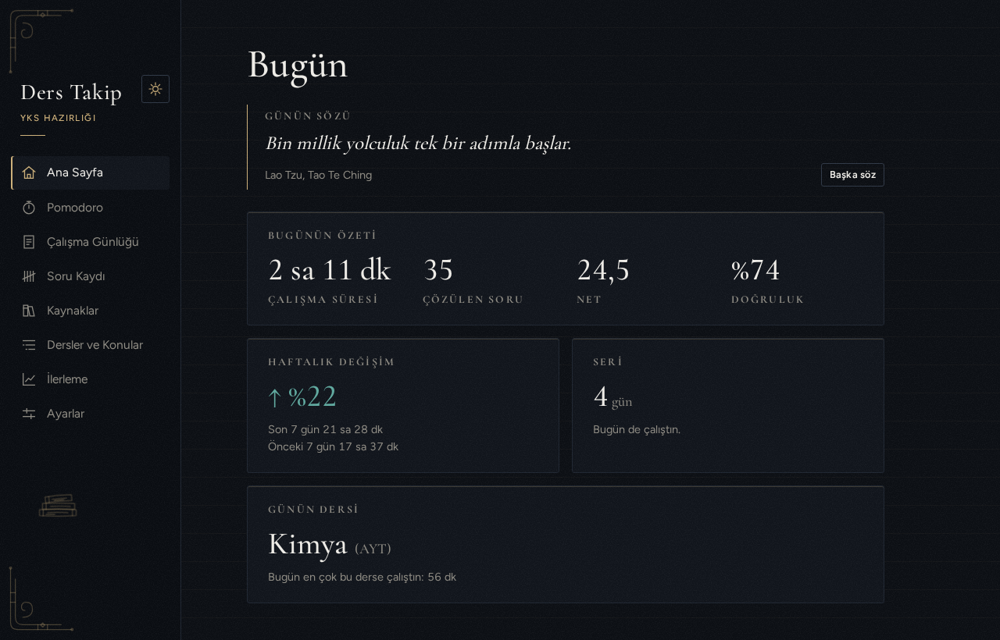
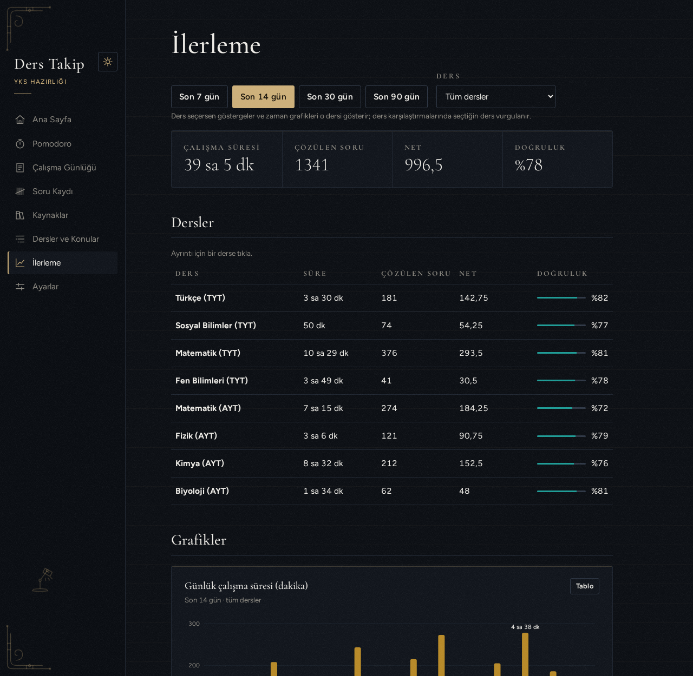
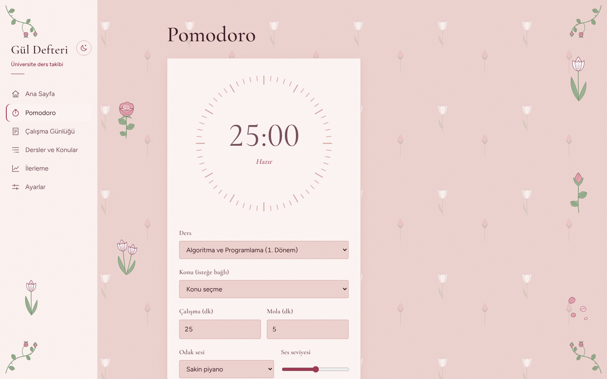
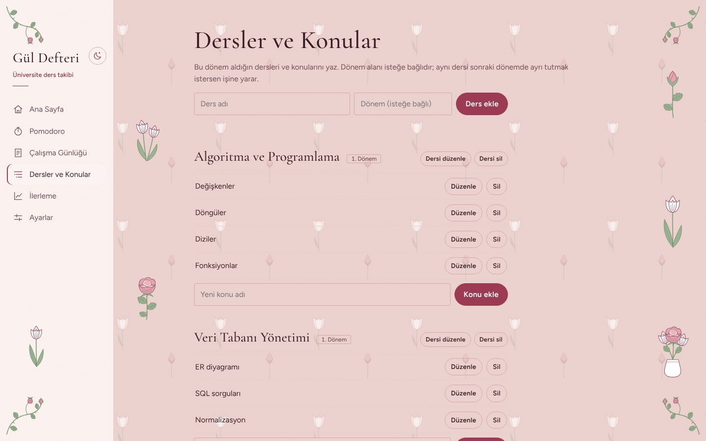
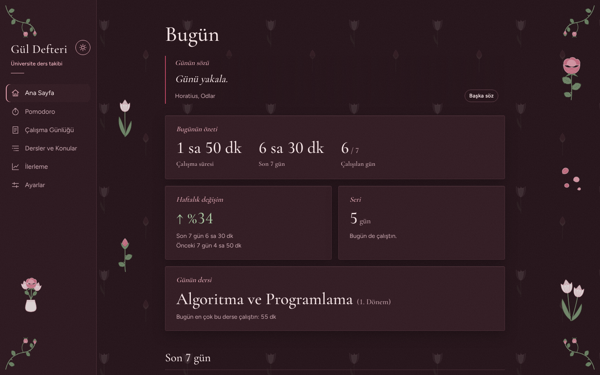
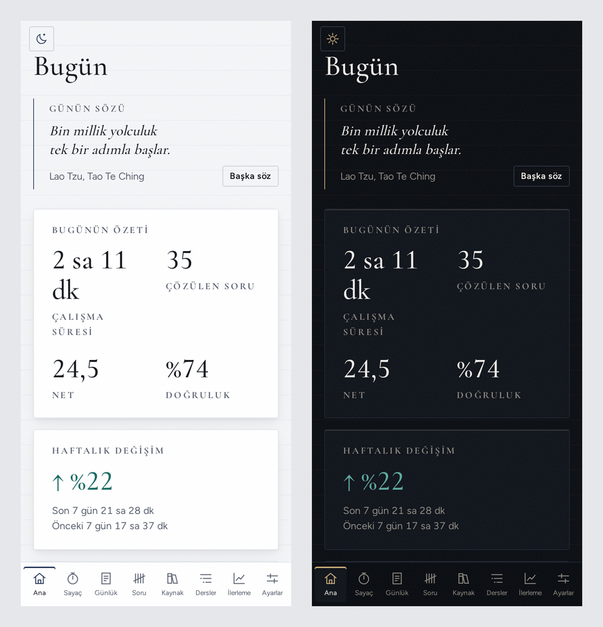

# Gül Defteri

**Üniversite dersleri için kişisel çalışma takip sitesi.** Pomodoro ile çalış, süreni derse ve konuya göre kaydet, ilerlemeni grafiklerle gör. Toz pembe zemin, beyaz laleler ve güller.


### 👉 [Siteyi aç](https://yusufoztoprak495-star.github.io/gul-defteri/)

Kurulum yok, hesap yok. Veriler yalnızca senin tarayıcında durur, hiçbir sunucuya gönderilmez. Telefonda "Ana ekrana ekle" ile uygulama gibi kurulur ve internetsiz de açılır.



> Bu proje, [Ders Takip](https://github.com/yusufoztoprak495-star/ders-takip) uygulamamın **üniversite kısmından** ayrıldı. YKS/DGS hedefleri, soru kaydı ve test kitabı takibi burada yok; yalnızca üniversite derslerinin çalışma süresi tutulur.

## Neler yapabilir?

| | |
| --- | --- |
| 🌹 **Gül bahçesi** | Ana sayfada son 7 günün her biri bir gül: o gün ne kadar çalıştıysan sapı o kadar uzar, gül goncadan tam açmışa doğru açılır. Hiç çalışmadığın gün yalnızca filiz kalır. |
| ⏱️ **Pomodoro** | Ders ve konu seçip sayacı başlat; süre dolunca çalışma kendiliğinden kaydedilir. Arkada sakin piyano, yağmur ya da gürültü çalabilir. |
| 📒 **Çalışma günlüğü** | Pomodoro dışındaki çalışmaları elle ekle. |
| 🗂️ **Dersler ve konular** | Bu dönem aldığın dersleri dönemiyle birlikte ekle, her derse konularını yaz. |
| 📈 **İlerleme** | Günlük ve haftalık süre, derslerin karşılaştırması; derse inip en çok çalıştığın konuları gör. |
| 🌙 **İki tema** | Varsayılan toz pembe; isteyene şarap rengi "gece gülü" koyu tema. |
| 💾 **Yedekleme** | Yedeği indir/yükle, haftalık hatırlatma, bilgisayarda bir klasöre günlük otomatik yedek. Ders Takip'in yedeği de yüklenebilir: üniversite dersleri gelir, sınav dersleri saklanır ama gösterilmez. |

## Ekran görüntüleri

| İlerleme | Pomodoro |
| --- | --- |
|  |  |

| Dersler ve konular | Gece gülü (koyu tema) |
| --- | --- |
|  |  |

<p align="center"></p>

> Görüntülerdeki veriler örnektir.

## Tasarım

- **Renkler:** toz pembe zemin (`#ecd2ce`), pembe-beyaz kâğıt kartlar, gül kurusu yazı, koyu gül vurgu (`#9c3a52`), adaçayı yeşili sap ve yapraklar. Yazılar WCAG AA kontrastını sağlar.
- **Motifler:** hepsi elle çizilmiş SVG (`client/src/components/Flowers.jsx`). Beyaz laleler; sarmal iç taçlı, katlanan yapraklı güller; çanak yapraklar, testere dişli gül yaprakları, sapta dikenler, düşmüş taç yaprakları. Köşelerde dikenli gül dalı, zeminde seyrek lale ve gonca deseni. Süsler içeriğin dışındaki boşluklarda durur, dar ekranda gizlenir.
- **Yazı tipi:** başlıklarda Cormorant Garamond, metinde Figtree; etiketler büyük harf yerine eğik serif.
- Renkler `client/src/rose.css` içindeki değişkenlerden gelir; bileşenlerde renk yazılmaz.

## Geliştirme

**Gereksinim:** [Node.js](https://nodejs.org) 22+.

```bash
npm install
npm run dev        # http://localhost:5173
```

| Komut | Ne yapar |
| --- | --- |
| `npm run dev` | Geliştirme sunucusu |
| `npm test` | Tüm testler (Vitest) |
| `npm run build` | Derler (`client/dist`) |
| `npm run preview` | Derlenmiş hâli dener: `http://localhost:4173` |

`main` dalına her gönderimde GitHub Actions testleri çalıştırır, derler ve derlenmiş siteyi `gh-pages` dalına yazar; GitHub Pages o daldan yayınlar (`.github/workflows/pages.yml`).

### Teknolojiler

| Katman | Seçim |
| --- | --- |
| Arayüz | React 19 + Vite, React Router (`HashRouter`) |
| Veri | Tarayıcıda IndexedDB, tek kayıt olarak (yazma atomik) |
| Çevrimdışı | Manifest + servis çalışanı (`client/public/sw.js`) |
| Grafikler ve çiçekler | Elle çizilmiş SVG, kütüphanesiz |
| Test | Vitest |

### Veriler

- Veriler tarayıcının deposunda durur (`gul-ders-takip` adıyla; Ders Takip ile aynı alan adında yayınlansa bile karışmaz).
- Doğrulama veri katmanındadır (`client/src/data/`); her girdiyi Türkçe mesajla reddeder.
- Gün sınırı yereldir: gece 00:30'daki çalışma o günün sayılır.
- Silinen konuya bağlı kayıtlar silinmez, konusuz kalır. Kaydı olan ders silinmez.
